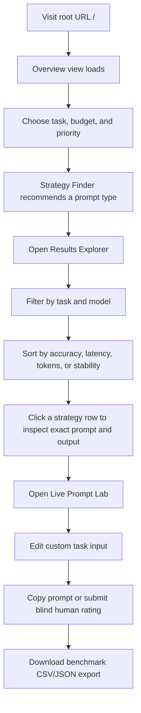
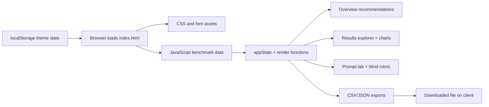
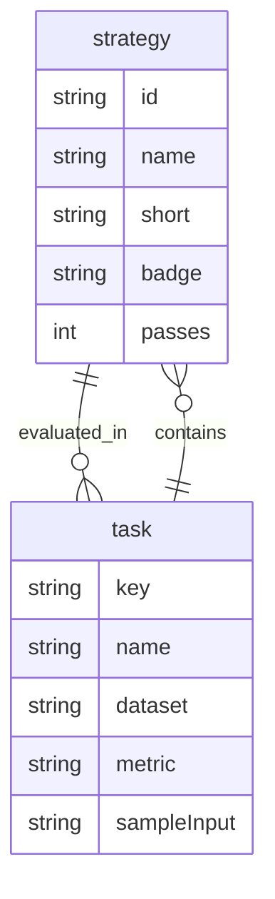

# PromptBench — Independent Prompt Strategy Observatory

PromptBench is a static, browser-based observatory for comparing prompt engineering strategies across common AI tasks. It is designed to answer one practical question: “Which prompt pattern works best for this task, while balancing accuracy, cost, and consistency?”

The website is intentionally lightweight and self-contained: all benchmark data, UI logic, charts, template generation, and interactive state live in a single file, [index.html](./index.html). There is no backend, no database, and no user authentication. This is a front-end-only research dashboard for comparing prompt strategies, not a production AI application.

## Table of Contents

- [1. Project Overview](#1-project-overview)
- [2. Key Features](#2-key-features)
- [3. Complete Website Pages & Navigation](#3-complete-website-pages--navigation)
- [4. Complete User Journey / Workflow](#4-complete-user-journey--workflow)
- [5. Technology Stack](#5-technology-stack)
- [6. Project Architecture](#6-project-architecture)
- [7. Folder and File Structure](#7-folder-and-file-structure)
- [8. Installation and Setup Guide](#8-installation-and-setup-guide)
- [9. Environment Variables](#9-environment-variables)
- [10. API Documentation](#10-api-documentation)
- [11. Database Documentation](#11-database-documentation)
- [12. Authentication and Security](#12-authentication-and-security)
- [13. UI/UX and Design System](#13-uiux-and-design-system)
- [14. Error Handling and Application States](#14-error-handling-and-application-states)
- [15. Deployment Guide](#15-deployment-guide)
- [16. Testing](#16-testing)
- [17. Known Limitations and Future Improvements](#17-known-limitations-and-future-improvements)
- [18. Troubleshooting](#18-troubleshooting)
- [19. Contribution Guidelines](#19-contribution-guidelines)
- [20. License and Acknowledgements](#20-license-and-acknowledgements)

## 1. Project Overview

### Website name
PromptBench — Independent Prompt Strategy Observatory

### What the website is about
This site presents a research-style comparison of six prompting strategies across five task domains:

- reasoning and math word problems
- summarisation
- classification
- structured extraction / JSON output
- creative writing

The project is a benchmarking dashboard for prompt design. It turns benchmark data into a practical recommendation engine that helps users quickly decide which prompt style is best for a given use case.

### Main purpose and objectives
The objective is to make prompt quality trade-offs visible. It communicates how the wording of a prompt affects:

- final answer accuracy
- human reader preference
- output format compliance
- word/token cost
- latency
- variability across repeated runs

This is not a live AI product and does not call external model endpoints. It is a static comparison site based on embedded benchmark values.

### Problem it solves
Prompt quality is highly sensitive to wording, template structure, and constraints. Many users treat a prompt as a single variable and overlook how much it affects speed, cost, or correctness. PromptBench makes those trade-offs obvious with examples, side-by-side comparisons, and recommendation logic.

### Target audience
- AI practitioners and researchers
- software developers evaluating prompt strategies
- product teams comparing LLM workflows
- students learning prompt engineering
- technical writers and analysts looking for benchmark insight

### Key highlights
- interactive strategy finder for task-specific recommendations
- benchmark explorer with filters and sorting
- live prompt builder and cost estimator
- blind human scoring form for comparative evaluation
- exact prompt/output comparison view
- CSV and JSON export of benchmark data
- theme toggle for light and dark modes
- no dependency installation or backend required

### What makes the platform useful or different
Unlike a generic AI demo, this website focuses on evidence-based comparison. It explains not only which strategy wins, but also why, how much it costs, and when it is worth using or avoiding. The design emphasizes user education and practical trade-off analysis rather than simply generating one canned answer.

## 2. Key Features

### 2.1 Interactive Strategy Finder
At the top of the Overview page, the user chooses:

- task type
- speed/word budget
- optimization priority

The UI then evaluates the available prompt strategies and picks the most suitable option. The core logic is in the `renderDecisionGuide()` function in [index.html](./index.html).

How it works internally:
- `TASKS` defines the five benchmark tasks and their metrics
- `STRATEGIES` defines the six prompting styles and their metadata
- `getAdjustedRun()` calculates benchmark values for a selected task, strategy, and model
- a budget filter removes strategies that exceed the chosen token or latency constraints
- the winner is ranked by either accuracy, human score, or stability
- the result is rendered into `#decision-output-box`

What the user sees:
- the selected task and budget controls
- a recommendation card with best strategy and metric delta
- a CTA button that jumps to the benchmark explorer

### 2.2 Benchmark Results Explorer
The Results view is the main comparison surface. It includes:

- task selector
- model selector
- raw vs delta score mode
- sort controls
- comparison table
- accuracy vs cost scatter/line visualization
- repeat-run consistency chart
- side-by-side prompt output comparison panel

The related logic is implemented in `renderResultsExplorer()`, `renderParetoSVG()`, `renderVarianceSVG()`, and `renderTraceDiffInspector()` in [index.html](./index.html).

How it works internally:
- `appState` stores the active task, model, sort mode, score mode, and selected comparison strategies
- rows are generated from `STRATEGIES` and `TASKS`
- `MODEL_MULTIPLIERS` slightly adjusts benchmark values for Llama, Mistral, and Qwen variants
- the `results-detail-tbody` table is rebuilt dynamically
- the SVG charts are re-rendered as the user changes filters
- clicking a table row updates the comparison pair at the bottom of the page

### 2.3 Live Prompt Lab
This section lets visitors construct a custom prompt, switch strategies, and estimate how expensive the prompt would be in real use. It is designed as a worked prompt sandbox rather than an execution engine.

Controls include:
- task selector
- prompt strategy selector
- custom input textarea
- blind-mode toggle
- copy prompt button
- reviewer rubric form

The feature is driven by `updatePromptLab()` in [index.html](./index.html).

How it works internally:
- `STRATEGY_TEMPLATES` contains the exact template text for each strategy
- `{{TASK_INPUT}}` is replaced with the user’s input
- the prompt length determines an estimated token count
- `passes` from the strategy metadata scales the total estimated cost
- the blind-mode selector hides the strategy name while still showing a sample answer

### 2.4 Blind Human Rating Log
The lab includes a reviewer panel that scores responses on:

- factual accuracy
- format compliance
- clarity/readability
- reviewer role
- notes/comment

It produces a mean score and appends a row to `humanRatingsLog`. The table updates immediately in the browser and is displayed in the recent evaluations table.

Important note: this is in-memory only; no storage backend persists the ratings.

### 2.5 CSV and JSON Benchmark Export
The footer includes three export buttons:

- `quick-export-csv-btn`
- `export-json-full-btn`
- `export-csv-full-btn`

These trigger `downloadDataset(format)` and generate a client-side CSV or JSON copy of the benchmark rows. This is a data export feature, not an API endpoint.

### 2.6 Theme Toggle
The header includes a single icon button that toggles between light and dark themes. The theme setting is stored in browser `localStorage` under the key `promptbench_theme`.

### 2.7 Public Dataset Reference Page
The final nav section, “Data Sources & Methodology,” provides the benchmark provenance. It links to public datasets and evaluation protocols, including:

- OpenAI GSM8K
- CAIS MMLU
- CNN / DailyMail
- GEM XSum
- Stanford SST-2
- AG News
- CoNLL-2003
- WritingPrompts
- Stanford HELM
- EleutherAI LM Eval

## 3. Complete Website Pages & Navigation

### 3.1 Important architectural fact: this project is a single-page app
The website does not use a real client-side router or separate HTML files for each page. Instead, it uses a single static document and toggles sections with CSS and JavaScript.

There are four visible view states, all served from the same root page:

| View ID | Visible label in navigation | Route / URL | What it contains |
|---|---|---|---|
| `view-overview` | “1. Overview & Strategy Finder” | `/` | landing page, recommendation engine, top winner cards |
| `view-results` | “2. Results & Visual Charts” | `/` | filters, benchmark matrix, charts, diff inspector |
| `view-lab` | “3. Live Prompt Tester & Grader” | `/` | prompt compiler, blind grader, review table |
| `view-methodology` | “4. Data Sources & Methodology” | `/` | public datasets, methodology, analysis notes |

The actual code uses `switchView(viewName)` to toggle the `.view-section` elements and `.nav-btn` active states. There are no URL path changes such as `/results` or `/lab` in the app code.

### 3.2 Overview & Strategy Finder
Route: `/` (same document, view toggled in-browser)

Purpose:
- introduce the website
- help users choose a good prompt strategy quickly
- show task-by-task winners

UI structure:
- sticky top header with brand and nav buttons
- centered hero section with title and summary
- three dropdown selectors: task, budget, priority
- strategy recommendation box
- winner cards for each task category
- full score matrix table

Interactive elements:
- `#dec-task`
- `#dec-budget`
- `#dec-priority`
- `#jump-explorer-btn`
- dynamic recommendation button inside the decision output box

What happens when used:
- selecting a task and budget filters possible strategies
- `renderDecisionGuide()` computes the recommended winner
- clicking the recommendation CTA switches to the Results view and sets the selected task/strategy context
- the overview matrix table is built dynamically by `renderOverviewMatrix()`

Data used:
- `STRATEGIES`
- `TASKS`
- `getAdjustedRun()`
- `appState.task`, `appState.view`

### 3.3 Results & Visual Charts
Route: `/` (same document, same root URL)

Purpose:
- compare all strategies for the selected task and model
- inspect metric deltas vs baseline
- read actual example prompt output pairs

UI structure:
- task filter radio group (5 tasks)
- model filter radio group (3 models)
- score display mode radio group (`raw` or `delta`)
- sort dropdown
- active view indicator
- benchmark table
- Pareto accuracy-vs-cost chart
- variance chart
- side-by-side prompt/output inspector

Interactive elements:
- `input[name="filter-task"]`
- `input[name="filter-model"]`
- `input[name="filter-mode"]`
- `#sort-select`
- `#reset-filters-btn`
- row click events on `results-detail-tbody`
- compare strategy selectors `#compare-strat-a` and `#compare-strat-b`

What happens when used:
- changing the task or model rebuilds the table and charts
- raw mode shows the benchmark score directly; delta mode shows gain vs zero-shot baseline
- row clicks set the comparison pair and update the prompt/output comparison section
- sorting is done by `appState.sortBy`

Rendered content sources:
- entries from `TASKS` and `MODEL_MULTIPLIERS`
- `STRATEGIES` metadata
- `STRATEGY_TEMPLATES` for sample prompt generation

The charts:
- **Pareto chart**: generated with `renderParetoSVG()`, showing “best value” points
- **variance chart**: generated with `renderVarianceSVG()`, plotting the five-run spread per strategy

### 3.4 Live Prompt Tester & Grader
Route: `/` (same SPA view)

Purpose:
- let a user generate a prompt in any supported strategy
- estimate prompt size and cost
- grade a sample answer without seeing the strategy label
- record recent human ratings

UI structure:
- task selector `#lab-task-select`
- strategy selector `#lab-strategy-select`
- custom input `#lab-custom-input`
- prompt preview `#lab-compiled-prompt-preview`
- token / pass / multiplier metrics
- blind output section `#blind-candidate-output`
- rubric form with accuracy, format, clarity, reviewer role
- review table `#human-log-tbody`

Interactive elements:
- change task / strategy
- type custom prompt input
- copy prompt to clipboard
- blind-mode checkbox
- rating submission

What happens when used:
- the template is compiled from `STRATEGY_TEMPLATES`
- `lab-custom-input` replaces the placeholder data
- estimated tokens are computed from the prompt length and strategy passes
- the form calculates a mean score and prepends a row to `humanRatingsLog`
- the UI immediately re-renders the recent review table

Important note:
- “Blind rating” is a front-end simulation, not a real review system
- no backend persists the ratings or user identity

### 3.5 Data Sources & Methodology
Route: `/` (same SPA view)

Purpose:
- explain the benchmark sources
- link to public datasets and evaluation methods
- summarize the real lessons learned from the benchmark data

UI structure:
- hero block with methodology framing
- dataset table with task categories, public sources, and metrics
- four “lessons learned” cards
- external links to benchmark references and evaluation tools

This is largely static content but it is consistent with the benchmark metadata used elsewhere in the app.

### 3.6 Footer actions
The footer contains the export controls:

- CSV export
- full JSON export
- quick CSV export

These are not page navigation; they are client-side file downloads created from the embedded data arrays.

## 4. Complete User Journey / Workflow

### Overview of the actual user flow


### First-time visitor experience
A first-time user generally follows this path:

1. The page loads on the Overview view.
2. The user chooses a task type and optimization goal.
3. The recommendation engine suggests the best prompt strategy.
4. The user moves into the Results view for deeper comparison.
5. The user can inspect side-by-side prompt/output pairs.
6. The user can test custom prompts in the Lab view.
7. The user can export the benchmark set or review methodology links.

### Registration and login flow
No registration flow exists. There are no login screens, no credentials, and no session system. The site does not support user accounts or protected pages.

### Main feature workflows
- Strategy recommendation workflow: done entirely on the client via dropdowns and `renderDecisionGuide()`
- Benchmark comparison workflow: built around `appState` + DOM rendering
- Prompt-generation workflow: built out of templates and text substitution
- Human review workflow: in-memory scoring and table updates only

### Data submission and processing
The project has no backend processing pipeline. Generated prompts and rubric data are processed locally in browser memory.

### Logout and account management
Not implemented. There is no account system or stateful user session to log out of.

## 5. Technology Stack

### Frontend
- HTML5
- CSS3
- JavaScript (plain ES6+)
- browser-rendered DOM updates
- no framework such as React, Vue, Angular, or Svelte

Why this is used:
- the site is a lightweight static benchmark dashboard and does not need a framework
- the application state is small and easily kept in a single JavaScript object
- the design emphasizes clarity and a single-page experience rather than complex component architecture

### Backend
No backend is implemented.

This project is not a full-stack app. It does not include:

- a web server
- an API layer
- database connection logic
- authentication service
- session storage backend
- user management

### Database
No database is used.

Benchmark values are stored directly in JavaScript objects in [index.html](./index.html):

- `STRATEGIES`
- `TASKS`
- `MODEL_MULTIPLIERS`
- `STRATEGY_TEMPLATES`
- `humanRatingsLog`

### Authentication and authorization
Not implemented.

The project has no:

- sign-up flow
- login flow
- role-based access control
- protected routes
- password hashing or token handling

### APIs and integrations
No live external APIs are called at runtime.

The site contains only:

- external font loads from jsDelivr
- clickable dataset links pointing to public benchmark resources
- local CSV/JSON exports generated in-browser

### Styling and UI libraries
- CSS variables for themeing
- custom typography from Google Fonts via jsDelivr
- no CSS framework such as Tailwind, Bootstrap, or Material UI

Fonts in use:
- Newsreader
- Public Sans
- IBM Plex Mono

### State management
The app uses a browser-side `appState` object combined with `localStorage`.

Examples:
- `appState.view`
- `appState.task`
- `appState.model`
- `appState.mode`
- `appState.sortBy`
- `appState.stratA`
- `appState.stratB`

Theme preference is saved via `localStorage.setItem('promptbench_theme', ...)`.

### Deployment and hosting
- static hosting compatible with Vercel
- configured through [vercel.json](./vercel.json)
- no server build step required

### Development tools
- plain browser HTML/JS/CSS
- Python static server for local preview
- no Node package management setup in the repository

### Research dependency file
The [requirements.txt](./requirements.txt) file contains Python package requirements for evaluation tooling, not the website runtime. It includes packages such as:

- `transformers`
- `torch`
- `accelerate`
- `datasets`
- `rouge-score`
- `scikit-learn`
- `numpy`
- `pandas`
- `tqdm`

This file appears to describe a prompt-evaluation pipeline or research environment, not the deployed website itself.

## 6. Project Architecture

### 6.1 High-level architecture diagram


### 6.2 Frontend architecture
The frontend is a single HTML document that holds:

- the entire DOM structure
- all CSS styles inside a `<style>` tag
- all benchmark data and logic inside a `<script>` tag
- event listeners attached through `window.addEventListener('DOMContentLoaded', ...)`

This architecture is intentionally compact and readable for educational use.

### 6.3 Event-driven rendering architecture
Rendering is driven by functions such as:

- `renderDecisionGuide()`
- `renderOverviewMatrix()`
- `renderResultsExplorer()`
- `renderParetoSVG()`
- `renderVarianceSVG()`
- `renderTraceDiffInspector()`
- `updatePromptLab()`
- `renderHumanRatingsTable()`
- `switchView()`

Each function updates the DOM in place rather than reloading a page or calling an API.

### 6.4 Data flow
```mermaid
flowchart TD
    A[STRATEGIES + TASKS + MODEL_MULTIPLIERS] --> B[getAdjustedRun()]
    B --> C[renderDecisionGuide()]
    B --> D[renderResultsExplorer()]
    D --> E[Table rows and SVG charts]
    A --> F[STRATEGY_TEMPLATES]
    F --> G[updatePromptLab()]
    G --> H[compiled prompt preview]
    G --> I[blind output panel]
    A --> J[downloadDataset()]
    J --> K[CSV/JSON file download]
```

### 6.5 Routing architecture
There is no client-side router library and no route config beyond the root static page. The app uses CSS classes and JavaScript state management to swap content sections.

The route fallback for deployment is configured in [vercel.json](./vercel.json):

```json
{
  "rewrites": [
    { "source": "/(.*)", "destination": "/index.html" }
  ]
}
```

This means all requests are effectively routed to the SPA entry file.

### 6.6 Authentication flow
None. There is no login or protected user journey.

### 6.7 External integration model
The app uses the browser to pull fonts from jsDelivr and to export local benchmark files. There are no API calls to model providers or backend services.

## 7. Folder and File Structure

Actual project structure:

```text
promptbench-main/
├── README.md
├── index.html
├── requirements.txt
├── vercel.json
└── (no package.json file present)
```

### Purpose of each file

- [index.html](./index.html): complete UI, styles, benchmark dataset, template library, chart generation, and event logic
- [README.md](./README.md): project documentation and onboarding guide
- [requirements.txt](./requirements.txt): research/evaluation dependency list; not required to run the website itself
- [vercel.json](./vercel.json): static hosting rewrite configuration

### Important observations
- There is no backend folder.
- There is no src/ directory.
- There is no app/ directory.
- There is no database folder.
- There is no package.json or lockfile.
- There is no `.env` file in the checked project tree.

## 8. Installation and Setup Guide

### 8.1 Prerequisites
- modern browser (Chrome, Edge, Firefox, Safari)
- Python 3.10+ (recommended for a simple local static server)
- network access for font loading from jsDelivr

### 8.2 Clone the project
```bash
git clone <repository-url>
cd promptbench-main
```

### 8.3 Install dependencies
There is no package manager install step for the website itself.

No command like this is required:

```bash
npm install
pnpm install
yarn install
```

The project is static and does not ship a framework package manifest.

### 8.4 Run locally
Use Python’s built-in HTTP server:

```bash
cd /path/to/promptbench-main
python3 -m http.server 8000
```

Then open:

```text
http://localhost:8000/
```

### 8.5 Open directly in a browser
Opening [index.html](./index.html) directly may work in some browsers, but a local HTTP server is the recommended method because it matches deployment conditions more closely and avoids browser restrictions around some features.

### 8.6 Vercel preview
If deploying to Vercel, the repository is already compatible with its static hosting mode:

```bash
vercel
```

Then follow the Vercel prompts to deploy the root folder.

## 9. Environment Variables

There are no required or optional environment variables used by this website.

### Verified status
- required: none
- optional: none
- `.env` file: none
- `.env.example`: none

### Why there are none
The app is a static HTML document with all data embedded in JavaScript at runtime. No server-side code reads environment variables or secrets.

### Example placeholder
```bash
# No environment variables required for this static site.
# No .env.example file is used by the current implementation.
```

## 10. API Documentation

There are no backend APIs in this project.

### Verified API status
| Type | Status |
|---|---|
| REST endpoints | None |
| GraphQL endpoints | None |
| WebSocket server | None |
| Server-side auth API | None |
| Model inference API | None |

### Export endpoints (client-side only)
The app exports benchmark data locally from the browser. This is not a server endpoint.

| Export | Trigger | Behavior |
|---|---|---|
| CSV | footer button | downloads benchmark table as `.csv` |
| JSON | footer button | downloads benchmark table as `.json` |

### Request and response format
No actual API request structure exists. The app simply serializes JavaScript objects to files using `Blob` and `URL.createObjectURL()`. 

### Authentication requirements
None. There are no bearer tokens, API keys, cookie sessions, or protected routes.

## 11. Database Documentation

There is no database.

### Database technology
- not applicable

### Tables and collections
- none

### Storage mechanism
All benchmark records and review log items are in JavaScript arrays and objects within [index.html](./index.html). This means the app state lives in memory and in browser `localStorage` only.

### Persistence behavior
- theme preference: persisted in `localStorage`
- human review log: kept in memory only during the page session
- benchmark data: embedded in the page script

### Example data structure
```javascript
const STRATEGIES = [
  { id: 'zero_shot', name: 'Zero-Shot (Basic Question)', ... },
  { id: 'few_shot', name: 'Few-Shot (3 Examples)', ... }
];

const TASKS = {
  reasoning: {
    name: 'Reasoning Problems',
    sampleInput: '...',
    runs: { ... }
  }
};
```

### ER-style conceptual model


## 12. Authentication and Security

### Current status
This project has no authentication or authorization layer.

### Implemented security-related features
- browser-local theme persistence via `localStorage`
- secure-ish client-only behavior without server-side secrets
- no password storage, API keys, or user credentials

### Not implemented
- account creation or sign-in
- session management
- password hashing
- role-based authorization
- secure cookies
- CSRF protection
- server-side input validation
- backend defenses against malicious input

### Input handling
User input is limited to:

- dropdown selections
- textarea content in the prompt lab
- scoring form values

These values are used directly on the client. There is no server to sanitize or validate them.

### Security conclusion
The current project is intentionally simple and low-risk because it does not process real user accounts or sensitive data. However, it is not a production security surface and should not be confused with a secure multi-user application.

## 13. UI/UX and Design System

### Overall design philosophy
The site uses a calm editorial aesthetic that resembles a research notebook or benchmark report rather than a consumer app dashboard. The design emphasizes simplicity and readability.

### Visual language
- warm paper tones in light mode
- neutral graphite palette in dark mode
- serif titles for a more analytical tone
- monospace labels for metrics and technical data
- thin rule lines and soft borders for clean structure

### Typography
From [index.html](./index.html):

- Newsreader for serif headings
- Public Sans for body text and interface controls
- IBM Plex Mono for metrics and code-like text

### Layout pattern
The interface uses:

- sticky top navigation bar
- large centered hero sections
- card-based content blocks
- tables with subtle borders and hover states
- responsive grid layouts with `display: grid` and `flex`

### Responsive behavior
The layout adapts to smaller screens using media queries and flexible containers. It maintains readability through stacked sections and simplified grids.

### Accessibility notes
- semantic button elements are used for navigation and actions
- the theme toggle includes an `aria-label`
- toast notifications use `role="status"` and `aria-live="polite"`
- contrast is designed for readability in both themes

### Reusable UI patterns
- card surfaces (`.calm-card`, `.winner-card`, `.chart-card`)
- pill radio controls for filter groups
- editorial buttons (`.btn-editorial`)
- metric tags (`.meta-pill`, `.tag-bracket`)
- code blocks (`.code-block`)
- table style (`.booktabs`)

## 14. Error Handling and Application States

Because this project is static, the app does not have backend error handling or API failure states. The script handles browser-side states directly.

### Loading states
There are no network-loading indicators. The content is embedded and renders immediately after the DOM is ready.

### Empty states
The app does not deliberately implement empty states because the dataset is always preloaded. Defensive code is used to fall back to defaults if a value is missing.

### Invalid inputs
The UI restricts choices via dropdowns and radio inputs. Where missing values could occur, the code falls back to defaults instead of crashing.

### User feedback
The app uses a toast banner (`#toast-banner`) for quick feedback, for example after:

- copying the compiled prompt
- resetting filters
- exporting benchmark data
- submitting a rating

### Failure handling examples in code
- `showToast()` exits quietly if the toast element is missing
- `localStorage` writes are wrapped in try/catch blocks
- `switchView()` toggles only existing `.view-section` elements
- `downloadDataset()` writes a file only if it can construct a `Blob`

### Success notifications
The toast system appears briefly using `setTimeout()` and then hides itself.

### Network and runtime behavior
There are no network errors because the app does not fetch remote model data. If the browser cannot load fonts, the layout still works with system fonts.

## 15. Deployment Guide

### Deployment target
The project is intended for static hosting, especially Vercel.

### Build and runtime requirements
There is no build process. The site is served directly as static content.

### Vercel configuration
The repository includes [vercel.json](./vercel.json), which rewrites all routes to `/index.html`:

```json
{
  "rewrites": [
    { "source": "/(.*)", "destination": "/index.html" }
  ]
}
```

This configuration is enough for Vercel to serve the SPA entry point.

### Deployment command
```bash
vercel deploy
```

### GitHub Pages option
This project is not configured for GitHub Pages in a custom way. It would require a static host configuration or a repository setup that serves `/index.html` as the root page. Vercel is the explicit deployment target in the repository.

### Domain configuration
Domain configuration can be managed in the hosting provider dashboard. The app itself contains no custom domain logic.

## 16. Testing

### Current state of testing
There is no automated test suite in the repository.

Verified project characteristics:
- no `package.json`
- no test runner configuration
- no unit tests
- no integration tests
- no E2E tests
- no CI configuration visible in the current file tree

### Manual verification strategy
The website can be validated by:

1. starting a local static server
2. loading the root page in a browser
3. switching through the four nav views
4. testing filter and sort behavior
5. checking chart rendering and prompt compilation
6. confirming the export buttons download files
7. verifying theme toggling and toast feedback

### Example manual verification command
```bash
cd /path/to/promptbench-main
python3 -m http.server 8000
```

Then open `http://localhost:8000/` in a browser.

## 17. Known Limitations and Future Improvements

### Existing limitations
- no real AI model execution
- no backend or data persistence
- benchmark values are hardcoded, not fetched from a live source
- no user accounts or saved experiments
- no database or analytics pipeline
- no real authentication or service security
- no API layer or integration with external providers

### Incomplete functionality
- prompt generation is conceptual and illustrative rather than executed against a live model
- blind review data is not stored beyond the current page session
- the site is a polished prototype rather than a production benchmarking platform

### Potential future improvements
- connect to a real model API or inference service
- add persistent benchmark storage
- add project/user accounts
- support custom dataset uploads
- add more benchmarks and model families
- add richer visual analytics and downloadable reports
- store human review logs server-side

## 18. Troubleshooting

### Issue: Site does not load correctly when opened via double-click
Solution:
- serve the project via a local web server instead of opening the raw file directly

```bash
cd /path/to/promptbench-main
python3 -m http.server 8000
```

Then open `http://localhost:8000/`.

### Issue: Theme does not persist
Cause:
- browser privacy settings or localStorage restrictions

Solution:
- load the page in a normal browser context
- clear site data and reload

### Issue: Clipboard copy fails
Cause:
- browser security restrictions in certain contexts

Solution:
- use localhost or a safe HTTPS environment
- the toast may still indicate the action completed

### Issue: Fonts do not load
Cause:
- network access to jsDelivr is blocked

Solution:
- ensure internet access is available
- the page still works with fallback system fonts

### Issue: The export buttons do not create a file
Cause:
- browser security or a script error

Solution:
- ensure the page loads without console errors
- test from a local HTTP server instead of a raw file

### Issue: The SPA does not route correctly on a hosting platform
Cause:
- static host is not configured for SPA fallback

Solution:
- ensure the hosting platform routes unknown paths to `/index.html` as in [vercel.json](./vercel.json)

## 19. Contribution Guidelines

### How to contribute
1. Fork the repository.
2. Create a feature branch.
3. Make a focused change to [index.html](./index.html) or related documentation.
4. Run the site locally with a static server.
5. Submit a pull request with a clear summary of the change.

### Recommended workflow
```bash
git checkout -b feature/my-improvement
```

Then:

```bash
python3 -m http.server 8000
```

Open the site in the browser and manually test the relevant UI behavior.

### Coding conventions
- keep the project static and lightweight
- prefer simple, readable JavaScript over unnecessary abstraction
- preserve the research dashboard aesthetic unless a real redesign is intended
- document major changes in the README
- avoid introducing a backend or framework unless the task explicitly requires it

### Pull request expectations
A good pull request for this project should clearly explain:

- which view or behavior was changed
- how the feature was validated manually
- whether benchmark values, UI text, or methodology sections changed
- whether the change preserves the SPA architecture

## 20. License and Acknowledgements

### License status
There is no explicit license file in the current project tree. As a result, no repository license is declared in the current state of the project.

### Acknowledgements
This project references open public datasets and benchmark resources, including:

- OpenAI GSM8K
- CAIS MMLU
- CNN / DailyMail
- GEM XSum
- Stanford SST-2
- AG News
- CoNLL-2003
- WritingPrompts
- Stanford HELM
- EleutherAI LM Eval

It also uses web font resources from jsDelivr.

### Summary
PromptBench is best described as an educational, benchmark-style front-end prototype. It does not implement backend APIs, data persistence, or user auth, but it does provide a clear and usable comparison framework for prompt engineering trade-offs across different tasks and strategies.
